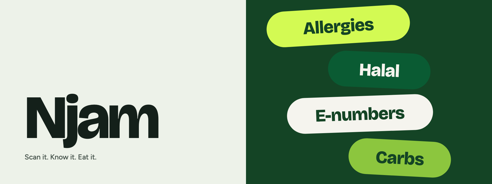
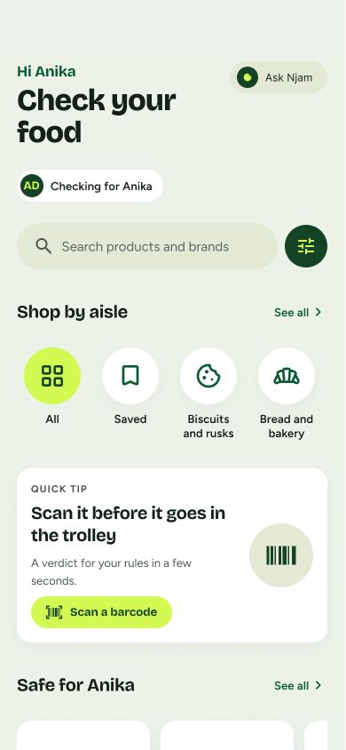
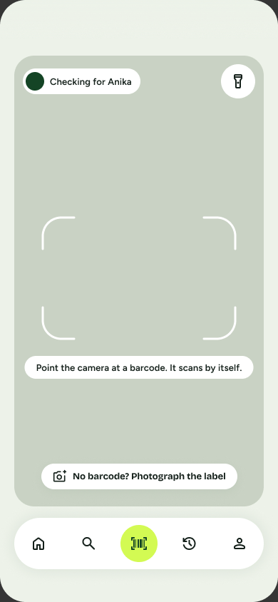
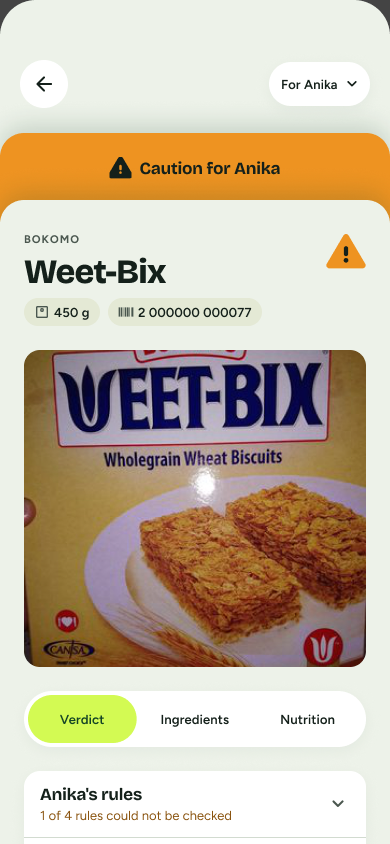
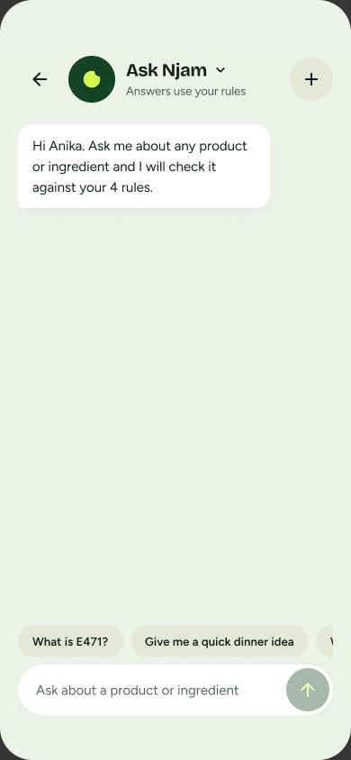

<div align="center">




# Njam

**Scan a barcode. Know if it fits your diet.**

An AI-driven grocery scanner for South Africa. You set your dietary rules once,
point the camera at a barcode, and get one of three answers in under three
seconds, with the reasons that produced it.


**Safe** &nbsp;·&nbsp; **Caution** &nbsp;·&nbsp; **Not safe**


[Screens](#screens) · [Getting started](#getting-started) · [Design system](#design-system) · [Documents](#project-documents)

</div>

---

Built for Interactive Development 300 (DV300) Theme 4 at Open Window. This is
assessed university work: the repository, the commit history and the author's
ability to explain every line are all marked.

---

## What it does

- **Set a profile once.** Allergies with severity, diet and faith, banned
  ingredients, E-numbers, nutrient limits, and health presets.
- **Scan a barcode.** The scanner always shows a scope pill so you know which
  household profile the scan runs against.
- **Get a verdict with reasons.** A verdict is a fact plus a reason: "Not safe.
  Contains milk solids, which you marked severe."

The engine is **hybrid**: the AI interprets (ingredient to category, aliases,
E-numbers, plain language) and deterministic code decides (numeric limits, hard
allergen blocks). On conflict, the rules engine wins. An unverified AI-read
record is capped at Caution and can never be Safe. **Zero false Safe verdicts**
is a stated project target.

---

## Screens

<!-- Add exports from Figma to docs/readme/screens/ and uncomment.
<p align="center">
  
  
  
  
</p>
-->

See every high-fidelity screen in [Figma](https://www.figma.com/design/SPM3c4yMgs3bW2BVRIoafz/Njam-App?node-id=1-8).

---

## Stack

| Layer   | Choice                                                              |
| ------- | ------------------------------------------------------------------ |
| App     | React Native via Expo, TypeScript, Expo Router                     |
| Camera  | `expo-camera`                                                      |
| AI      | Google Gemini, behind a single service module (`src/services/ai`)  |
| Backend | Supabase: PostgreSQL, Auth, Storage, Edge Functions                |
| State   | React Context + AsyncStorage                                       |
| Fonts   | Bricolage Grotesque (display), Figtree (text)                      |
| Icons   | Material Symbols Rounded                                           |

---

## Getting started

1. Install dependencies:

   ```bash
   npm install
   ```

2. Set up environment variables. Copy the example and fill in your Supabase
   values. `.env` is git-ignored and must never be committed.

   ```bash
   cp .env.example .env
   ```

   Only the publishable (anon) key belongs in the app. The Supabase secret key
   and the Gemini key live in Edge Function secrets, never in app code.

3. Start the app:

   ```bash
   npx expo start
   ```

   Test on a **physical phone** through Expo Go. The core feature is the camera,
   and a simulator cannot scan a barcode.

---

## Backend

- **Database.** `supabase/migrations` holds the schema and a seed of 25 South
  African products. The seed barcodes are placeholders (GS1 prefix `200`, never
  printed on a real pack); swap in a real barcode to scan a real product.
  Their photos and nutrition tables come from
  [Open Food Facts](https://openfoodfacts.org) (photos CC BY-SA, data ODbL,
  by Open Food Facts contributors), matched by name and checked by hand; see
  the `seed_photos_nutrition` migration for each product's source.
- **Label reading.** `supabase/functions/scan-label` sends a label photo or
  ingredient text to Gemini and validates the JSON it returns. The Gemini key is
  an Edge Function secret (`GEMINI_API_KEY`) and never reaches the app. Deploy
  it with:

  ```bash
  npx supabase functions deploy scan-label --project-ref <your-project-ref>
  ```

- **Ask Njam.** `supabase/functions/ask-njam` is the assistant. It reads your
  rules, recent scans and conversation with your own JWT (so Row Level Security
  applies), asks Gemini for JSON blocks, validates them, and saves the exchange
  to `chat_conversations` and `chat_messages`. A second mode,
  `{ "mode": "complete" }`, returns ghost text while you type. The AI never
  decides a verdict: the app runs the verdict engine on any product it names.

  ```bash
  npx supabase functions deploy ask-njam --project-ref <your-project-ref>
  ```

- **Test accounts.** Two accounts exist for the demo: a Household Owner and an
  Admin/Moderator. Their passwords are shared privately, never committed.

---

## Project structure

The short version:

```
src/
  app/                 Expo Router routes (file-based navigation)
  components/
    design-system/     Reusable UI built from tokens (Button, Chip, VerdictMark, ...)
  features/            One folder per screen area (auth, scanner, verdict, ...)
  services/
    ai/                The single Gemini provider module (swap provider here)
    verdict/           The deterministic rules engine
  theme/
    tokens.ts          The local source of truth for every design value
  lib/                 Shared clients, e.g. the Supabase client
supabase/
  migrations/          SQL schema, Row Level Security on from the first migration
docs/                  Structure, workflow, design system, scope, API, AI, testing, risks, plan
```

Full explanation and the reasoning behind it: [`docs/STRUCTURE.md`](docs/STRUCTURE.md).

---

## Design system

The high-fidelity screens are in Figma (view only):
<https://www.figma.com/design/SPM3c4yMgs3bW2BVRIoafz/Njam-App?node-id=1-8>

The source of truth is the Njam Design System artifact:
<https://claude.ai/artifact/3gFmougXCaYTd2YWEP8VYy>

The artifact is private to the author's Claude account and cannot be opened from
this repo. Its values are mirrored into
[`src/theme/tokens.ts`](src/theme/tokens.ts), which is the source of truth for
code. Screens and components import from `tokens.ts` and never type a raw hex
code, size, spacing or radius. How the artifact and the code stay linked:
[`docs/DESIGN-SYSTEM.md`](docs/DESIGN-SYSTEM.md).

---

## Git workflow

`main` always holds the latest working code. Each feature is built on its own
branch (`anika/scanner`, `anika/ask-njam`, ...) and merged into `main` with
`git merge --no-ff` once it works, so a merge commit groups the feature's
commits. There are no Pull Requests. Commit history frequency and quality are
directly assessed. Conventions and the full workflow:
[`docs/GIT-WORKFLOW.md`](docs/GIT-WORKFLOW.md).

---

## Project documents

| Document | What it covers |
| --- | --- |
| [`docs/SCOPE.md`](docs/SCOPE.md) | The frozen MVP (Must, Nice, Future) and changes since the pitch |
| [`docs/API.md`](docs/API.md) | Every route the app calls, with request and response examples |
| [`docs/AI-PROMPTS.md`](docs/AI-PROMPTS.md) | Both Gemini prompts, output validation, loading and error states |
| [`docs/TESTING.md`](docs/TESTING.md) | Core flow checklist, bug log, usability tests |
| [`docs/RISKS.md`](docs/RISKS.md) | Technical risks from the pitch and how each was handled |
| [`docs/PLAN.md`](docs/PLAN.md) | Sprints 3 and 4 through to the final hand-in |

---

## Screen plan (10)

Auth · Onboarding · Home/Search · Scanner · Verdict · Alternatives · Add a
product · Profile & filters · Household · Admin review queue. The brief requires
a minimum of five; ten are planned.

Built so far (13 Oct 2026): Auth, Home and Search, Scanner, Verdict, History,
Profile (rules read-only), Admin review queue, and Ask Njam, the AI assistant.
Still to build: Onboarding with rule editing, Alternatives, Add a product and
Household. Priorities are in [`docs/PLAN.md`](docs/PLAN.md).

## Roles

Household Owner · Standard User · Admin/Moderator.

## Database (16 tables)

`households` · `users` · `diet_profiles` · `profile_rules` · `scans` ·
`categories` · `products` · `nutrition_facts` · `product_ingredients` ·
`ingredients` · `allergens` · `chat_conversations` · `chat_messages` · `saved_products` · `stores` ·
`product_stores`.
Row Level Security is on for every table from the migration that creates it.
The two chat tables hold saved Ask Njam conversations, each private to the
person who had it. `saved_products` holds the products a household
bookmarked, shared by everyone in it. `stores` and `product_stores` say which shops and
websites sell each product.

---

## Deadlines

- Progress Milestone (30%): weeks 12–14, live code review.
- Final application (60%): Wed 28 Oct 2026, 14:00. Public GitHub repo, full
  README, and a 5–8 minute demonstration video.

## License

See [`LICENSE`](LICENSE).
