<div align="center">


**Scan a barcode. Know if it fits your diet.**

An AI-driven grocery scanner for South Africa. You set your dietary rules once,
point the camera at a barcode, and get one of three answers in under three
seconds, **Safe**, **Caution** or **Not safe**, with the reasons that produced it.


**[Watch the demo video](#demo-video)** · [Screens](#screens) · [Getting started](#getting-started) · [How to use it](#how-to-use-it) · [The AI](#the-ai)

</div>

---

Built by Anika de Beer for Interactive Development 300 (DV300), final
application, Open Window, October 2026.

## Contents

- [Demo video](#demo-video)
- [The problem](#the-problem)
- [Who it is for](#who-it-is-for)
- [What it does](#what-it-does)
- [Screens](#screens)
- [How a scan works](#how-a-scan-works)
- [The AI](#the-ai)
- [Architecture and stack](#architecture-and-stack)
- [Getting started](#getting-started)
- [How to use it](#how-to-use-it)
- [Data, roles and security](#data-roles-and-security)
- [Testing](#testing)
- [Project structure](#project-structure)
- [Design system](#design-system)
- [Git workflow](#git-workflow)
- [Project documents](#project-documents)
- [Contributions](#contributions)
- [References and acknowledgements](#references-and-acknowledgements)

---

## Demo video

**[Watch the 5 to 8 minute demonstration](VIDEO_LINK_HERE)**

The video walks through signing up, setting your rules, scanning a barcode,
reading a label photo with the AI, asking Njam a question, managing a
household and verifying a product as an admin.

---

## The problem

In a South African shop, the label on the pack is the only safety check
you get, and it is hard to read in an aisle.

- **Allergens hide behind other names.** Whey and casein are milk. Lecithin
  is often soya. Spelt is wheat. You have to know every alias, every time.
- **E-numbers mean nothing to most shoppers.** E120 is made from insects,
  and E471 can come from animal fat. That matters if you eat halal, kosher
  or vegan.
- **One trolley, many rules.** One person often shops for a household where
  a child has a severe peanut allergy, a parent eats halal and a grandparent
  counts carbs.
- **Local products are missing from international apps.** Many South
  African barcodes are not in global food databases, so existing scanners
  often return nothing.

Getting it wrong is not an inconvenience. For someone with a severe allergy,
a wrong "it's fine" is a health incident.

**Theme area:** Healthcare, with a strong Accessibility angle: a verdict is
never carried by colour alone.

## Who it is for

**Primary audience: the household owner.** The person who does the shopping
for a family where each person has their own allergies, diet or faith rules.
They need a fast, trustworthy answer in the shop, for the right person,
without reading every label.

**Also for:**

- People with diet or faith rules: halal, kosher, vegetarian, vegan, no
  caffeine.
- People with health limits: carbs for diabetes, sodium for blood pressure.

## What it does

- **Set your rules once.** Your profile has six layers: allergies with
  severity, diet and faith, banned ingredients, E-numbers, nutrient limits
  and health presets.
- **Scan a barcode.** Press the round button to photograph it. The number
  floats up as Njam reads it; if it will not read, type it instead.
- **Get a verdict with reasons.** Safe, Caution or Not safe, each with a
  shape, a word and a reason: "Not safe. Contains milk solids, which you
  marked severe."
- **Read a label with AI.** If Njam does not know a product, photograph the
  ingredient list. Google Gemini reads it, and the verdict says the list
  has not been checked by our team yet.
- **Ask Njam.** An AI assistant that knows your rules and recent scans:
  ask why something is not safe, for a safer swap, or for a recipe.
- **Find alternatives.** Safer products in the same category.
- **Share a household.** Everyone in a household can see each other's
  rules, so you can shop for each other, including children without a phone.
- **Review queue.** An admin verifies products added from label photos, so
  the next person gets a checked answer.
- **Keep a history.** Every scan is saved and reopens exactly as it was
  decided.

The catalogue holds about a thousand South African products, most of them
imported from [Open Food Facts](https://openfoodfacts.org) with no AI involved.

---

## Screens

High-fidelity designs from [Figma](https://www.figma.com/design/SPM3c4yMgs3bW2BVRIoafz/Njam-App?node-id=1-8).
Each one is built in the app.

<table>
  <tr>
    <td align="center">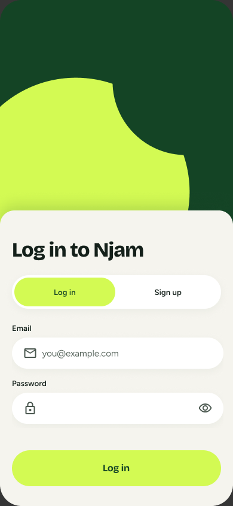<br /><sub>Log in</sub></td>
    <td align="center">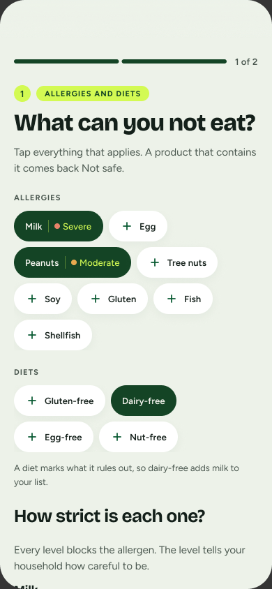<br /><sub>Onboarding</sub></td>
    <td align="center">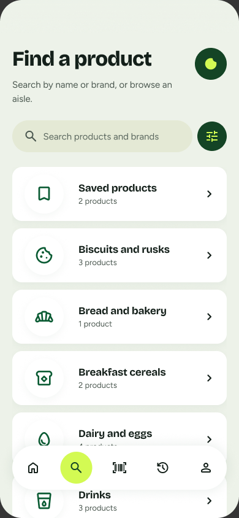<br /><sub>Search</sub></td>
    <td align="center"><br /><sub>Scanner</sub></td>
  </tr>
  <tr>
    <td align="center"><br /><sub>Verdict</sub></td>
    <td align="center">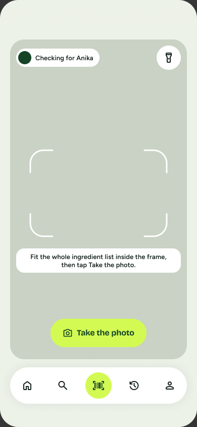<br /><sub>Add a product</sub></td>
    <td align="center"><br /><sub>Ask Njam</sub></td>
    <td align="center">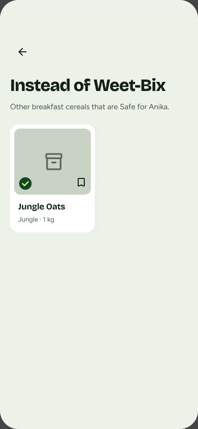<br /><sub>Alternatives</sub></td>
  </tr>
  <tr>
    <td align="center">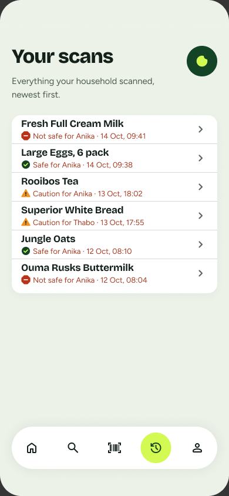<br /><sub>History</sub></td>
    <td align="center">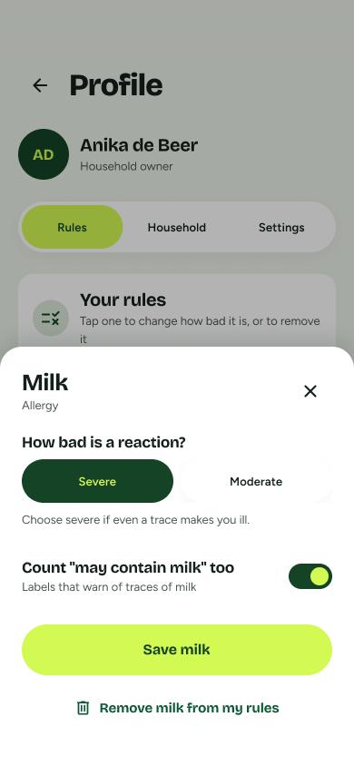<br /><sub>Edit a rule</sub></td>
    <td align="center">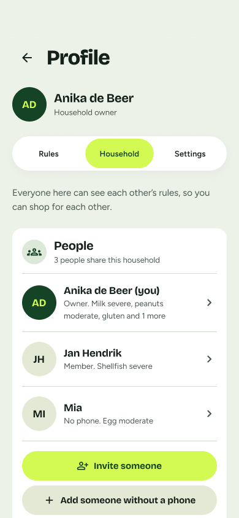<br /><sub>Household</sub></td>
    <td align="center">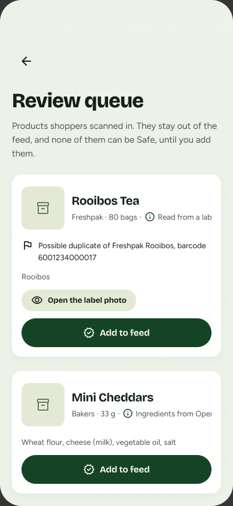<br /><sub>Admin review queue</sub></td>
  </tr>
</table>

---

## How a scan works

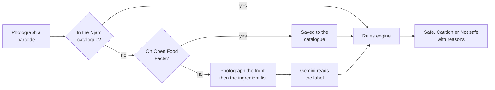

A product from Open Food Facts is saved to the catalogue on its first scan,
so the next scan finds it straight away. Its list is judged by how complete
it is: with at least three ingredients it is decided like a verified product.
With fewer, it is always **Caution**, because the missing part may hold your
allergen, and it is hidden from Home.

A label photo, or a product a shopper added, is unverified. It can still be
**Safe** or **Not safe**, and its verdict says our team has not checked the
list. If your profile has a severe allergy, an unverified list is capped at
**Caution**, because a misread label is most dangerous there. When in doubt,
the engine moves toward Caution, never toward Safe.

## The AI

**The AI interprets. The rules engine decides.**

Njam uses Google Gemini (`gemini-flash-lite-latest`) in two places, both
inside Supabase Edge Functions so the API key never reaches the phone.

| Where | What Gemini does | What it never does |
| --- | --- | --- |
| `scan-label` | Reads an ingredient list (and the front of the pack) from a photo, and maps ingredients, aliases and E-numbers to allergens | Decide a verdict, or guess ingredients it cannot see |
| `ask-njam` | Answers questions using your rules, recent scans and the catalogue, and suggests the next words while you type | Give a product a verdict: the app runs the rules engine on every product it names |

**Guardrails**

- `temperature: 0`, so it reads the label as printed.
- Structured JSON output with a schema, so it must answer in Njam's shape.
- Every answer is validated before the app sees it. Unknown allergens are
  dropped and E-numbers are normalised. If nothing is usable, the label
  counts as unreadable.
- Every AI-read record is unverified and its verdict says so. For a severe
  allergy it is capped at Caution. On a conflict, the rules engine wins.

Both prompts, the validation rules, and the loading and error states are
documented in [`docs/AI-PROMPTS.md`](docs/AI-PROMPTS.md).

---

## Architecture and stack

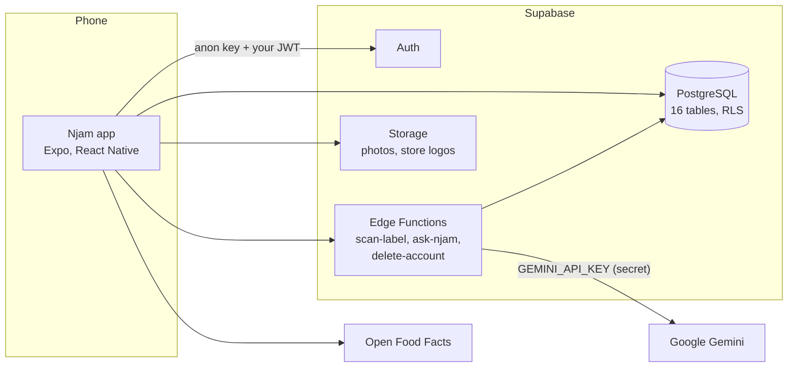

| Layer   | Choice                                                              |
| ------- | ------------------------------------------------------------------ |
| App     | React Native via Expo (SDK 58), TypeScript, Expo Router             |
| Camera  | `expo-camera`                                                      |
| AI      | Google Gemini, behind a single service module (`src/services/ai`)  |
| Backend | Supabase: PostgreSQL, Auth, Storage, Edge Functions                |
| Product data | Njam's own catalogue, plus [Open Food Facts](https://openfoodfacts.org) |
| State   | React Context + AsyncStorage                                       |
| Fonts   | Bricolage Grotesque (display), Figtree (text)                      |
| Icons   | Material Symbols Rounded                                           |

Every route the app calls, with request and response examples, is in
[`docs/API.md`](docs/API.md).

---

## Getting started

### What you need

- [Node.js](https://nodejs.org) 20 or newer, and npm.
- A phone with **Expo Go** installed ([iOS](https://apps.apple.com/app/expo-go/id982107779),
  [Android](https://play.google.com/store/apps/details?id=host.exp.exponent)).
  The core feature is the camera, and a simulator cannot scan a barcode.
- A [Supabase](https://supabase.com) project (the free plan is enough).
- A Google Gemini API key from [Google AI Studio](https://aistudio.google.com/apikey).

### 1. Frontend: install the app

```bash
git clone https://github.com/OpenWindow231312/njam-app.git
```

```bash
cd njam-app
```

```bash
npm install
```

Copy the example environment file and fill in your Supabase project URL and
publishable (anon) key, from **Project Settings, API** in Supabase:

```bash
cp .env.example .env
```

`.env` is git-ignored and must never be committed. Only the publishable key
belongs in the app. The Supabase secret key and the Gemini key live in Edge
Function secrets, never in app code.

### 2. Database: create the tables

Link the project and apply every migration in `supabase/migrations`. This
creates all 16 tables with Row Level Security, and seeds 25 South African
products, stores and categories.

```bash
npx supabase login
```

```bash
npx supabase link --project-ref <your-project-ref>
```

```bash
npx supabase db push
```

The seed barcodes are placeholders (GS1 prefix `200`, never printed on a real
pack). To try a real product, scan any barcode: Njam will look it up on Open
Food Facts or ask for a label photo.

### 3. Backend: the Edge Functions

Store the Gemini key as a secret, then deploy the four functions:

```bash
npx supabase secrets set GEMINI_API_KEY=<your-gemini-key>
```

```bash
npx supabase functions deploy scan-label --project-ref <your-project-ref>
```

```bash
npx supabase functions deploy ask-njam --project-ref <your-project-ref>
```

```bash
npx supabase functions deploy delete-account --project-ref <your-project-ref>
```

```bash
npx supabase functions deploy import-open-food-facts --project-ref <your-project-ref>
```

To fill the catalogue, import South African products from Open Food Facts.
It asks for an admin's email and password in the terminal (never stored),
then imports 50 products a page. It is safe to run again: a barcode already
in the catalogue is skipped.

```bash
node --env-file=.env scripts/import-open-food-facts.mjs
```

`SUPABASE_URL`, `SUPABASE_ANON_KEY` and `SUPABASE_SERVICE_ROLE_KEY` are
provided to Edge Functions by Supabase automatically.

### 4. Run it

```bash
npx expo start
```

Scan the QR code with your phone's camera (iOS) or the Expo Go app
(Android). Your phone and computer must be on the same network.

### Test accounts

Two accounts exist on the hosted project for marking:

| Account | Role | Use it to |
| --- | --- | --- |
| `owner@njam.test` | Household Owner, with a child's profile in the household | Scan, see verdicts, Ask Njam, manage the household |
| `admin@njam.test` | Admin/Moderator | Open the review queue and verify products |

The passwords are shared with the lecturer privately and are never committed.
On your own Supabase project, sign up in the app instead. To make yourself an
admin, run this in the Supabase SQL editor (the app itself cannot change a
role):

```sql
update public.users set role = 'admin'
where id = (select id from auth.users where email = 'you@example.com');
```

---

## How to use it

1. **Sign up or log in.** New accounts go through onboarding: choose your
   allergies and how severe each one is, then diets, faith rules,
   ingredients and E-numbers you avoid.
2. **Home** shows aisles, saved products and what is safe for you. The Njam
   mark at the top right opens **Ask Njam**.
3. **Search** finds products by name, filtered by verdict, aisle or store.
4. **Scan** (the centre tab) opens the camera. Fit the barcode in the
   frame and press the round button. If it will not read, type the number.
   If Njam does not know the product, it asks for a photo of the front of
   the pack, then of the ingredient list.
5. **The verdict** shows the mark, the word and the reasons. The tabs show
   the ingredients (with the ones that broke a rule highlighted) and the
   nutrition. Below that, you can see who in the household can eat it,
   where to buy it, and safer alternatives.
6. **History** lists every scan. Tap one to reopen it as it was decided.
7. **Profile** has three tabs. **Rules** lets you add, edit or remove a
   rule. **Household** lets you add people, with or without a phone, and
   invite someone with a code. **Settings** covers your account, and lets
   you delete your account and data.
8. **Admin only:** Profile, Settings, **Review queue** lists products added
   from label photos. Verifying one lets it become Safe.

---

## Data, roles and security

**Roles:** Household Owner · Standard User · Admin/Moderator.

**Database (16 tables):** `households` · `users` · `diet_profiles` ·
`profile_rules` · `scans` · `categories` · `products` · `nutrition_facts` ·
`product_ingredients` · `ingredients` · `allergens` · `chat_conversations` ·
`chat_messages` · `saved_products` · `stores` · `product_stores`.

- **Row Level Security is on for every table** from the migration that
  creates it. You read and write only your own household's rows, even when
  calling the API directly.
- **Nobody can promote themselves.** A person cannot change their own role or
  household from the app. Only an admin can verify a product, and the
  database checks that too.
- **Rules are generic.** `profile_rules` stores `type`, `target`, `operator`
  and `threshold`, so a new kind of rule needs no migration.
- **Secrets stay on the server.** The app holds only the publishable key. The
  Gemini key and the service role key live in Edge Function secrets.
- **Validation and feedback.** Forms validate before saving. Every AI answer
  is validated on the server. Loading, empty and error states name what
  happened and what to do next.

---

## Testing

```bash
npm test
```

There are 50 automated tests covering ingredient aliases, alternatives and
how Open Food Facts records are decided.
They run with Node's built-in test runner.

[`docs/TESTING.md`](docs/TESTING.md) holds the core flow checklist, the bug
log, and usability tests with people outside the project. What they
struggled with became logged bugs and fixes, for example catching caffeine
in tea and coffee, alternatives of the same kind, product names in History
and clearer Caution copy.

---

## Project structure

```
src/
  app/                 Expo Router routes (file-based navigation)
  components/
    design-system/     Reusable UI built from tokens (Button, Chip, VerdictMark, ...)
  features/            One folder per screen area (auth, scanner, verdict, ...)
  services/
    ai/                The single Gemini provider module (swap provider here)
    verdict/           The deterministic rules engine
  theme/
    tokens.ts          The local source of truth for every design value
  lib/                 Shared clients, e.g. the Supabase client
supabase/
  migrations/          SQL schema, Row Level Security on from the first migration
  functions/           Edge Functions: scan-label, ask-njam, delete-account
docs/                  Structure, workflow, design system, scope, API, AI, testing, risks, plan
```

Full explanation and the reasoning behind it: [`docs/STRUCTURE.md`](docs/STRUCTURE.md).

---

## Design system


The high-fidelity screens are in Figma (view only):
<https://www.figma.com/design/SPM3c4yMgs3bW2BVRIoafz/Njam-App?node-id=1-8>

The source of truth is the Njam Design System artifact, open to anyone with the link:
<https://claude.ai/artifact/3gFmougXCaYTd2YWEP8VYy>

Its values are mirrored into [`src/theme/tokens.ts`](src/theme/tokens.ts),
which is the source of truth for code. Screens and components import from
`tokens.ts` and never type a raw hex code, size, spacing or radius. How the
artifact and the code stay linked: [`docs/DESIGN-SYSTEM.md`](docs/DESIGN-SYSTEM.md).

A verdict is never carried by colour alone: **circle = Safe, triangle =
Caution, octagon = Not safe**, always with the word and a reason.

---

## Git workflow

`main` always holds the latest working code. Each feature is built on its own
branch (`anika/scanner`, `anika/ask-njam`, ...) and merged into `main` with
`git merge --no-ff` once it works, so a merge commit groups the feature's
commits. There are no Pull Requests. Conventions and the full workflow:
[`docs/GIT-WORKFLOW.md`](docs/GIT-WORKFLOW.md).

---

## Project documents

| Document | What it covers |
| --- | --- |
| [`docs/SCOPE.md`](docs/SCOPE.md) | The frozen MVP (Must, Nice, Future) and changes since the pitch |
| [`docs/API.md`](docs/API.md) | Every route the app calls, with request and response examples |
| [`docs/AI-PROMPTS.md`](docs/AI-PROMPTS.md) | Both Gemini prompts, output validation, loading and error states |
| [`docs/TESTING.md`](docs/TESTING.md) | Core flow checklist, bug log, usability tests |
| [`docs/RISKS.md`](docs/RISKS.md) | Technical risks from the pitch and how each was handled |
| [`docs/PLAN.md`](docs/PLAN.md) | Sprints 3 and 4 through to the final hand-in |

---

## Contributions

This is a solo project. **Anika de Beer** (231312) did the research, UX and
UI design, design system, front end, database, Edge Functions, AI
integration, testing and documentation.

Claude (Anthropic) was used as a coding assistant during development. Every
change was reviewed, tested on a phone and committed by the author.

## References and acknowledgements

- [Expo](https://docs.expo.dev) and [Expo Router](https://docs.expo.dev/router/introduction/) documentation.
- [Supabase](https://supabase.com/docs) documentation: Auth, Row Level Security, Edge Functions.
- [Google Gemini API](https://ai.google.dev/gemini-api/docs) documentation, including structured output.
- [Open Food Facts](https://openfoodfacts.org): product photos (CC BY-SA)
  and data (ODbL), by Open Food Facts contributors. Each seeded product's
  source is listed in the `seed_photos_nutrition` migration.
- [Bricolage Grotesque](https://fonts.google.com/specimen/Bricolage+Grotesque)
  and [Figtree](https://fonts.google.com/specimen/Figtree), Google Fonts,
  SIL Open Font License.
- [Material Symbols Rounded](https://fonts.google.com/icons), Google,
  Apache License 2.0.
- Store logos belong to their owners and are shown only to say where a
  product is sold.
- Usability testers: Nicolene Smit and Jan Hendrik, who tried the core flow
  without help.
- Built for Interactive Development 300 at Open Window.

## License

See [`LICENSE`](LICENSE).
